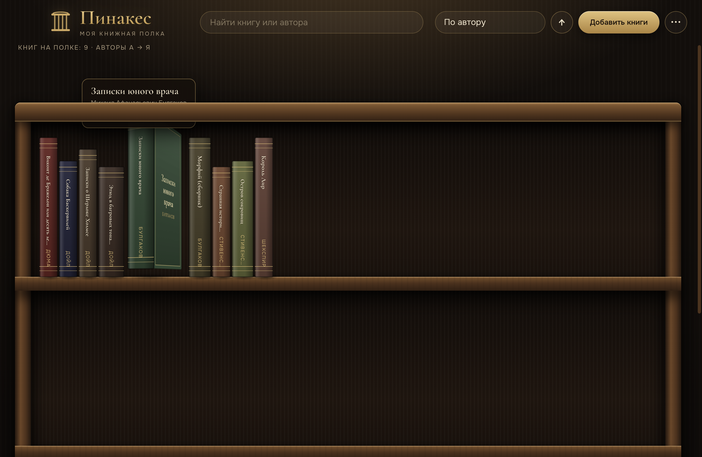
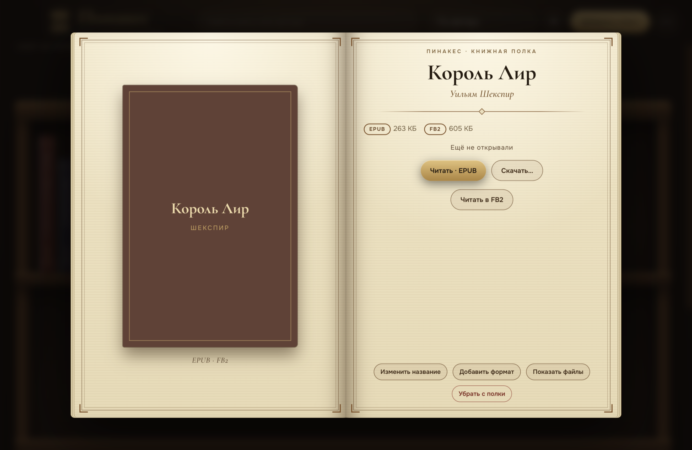
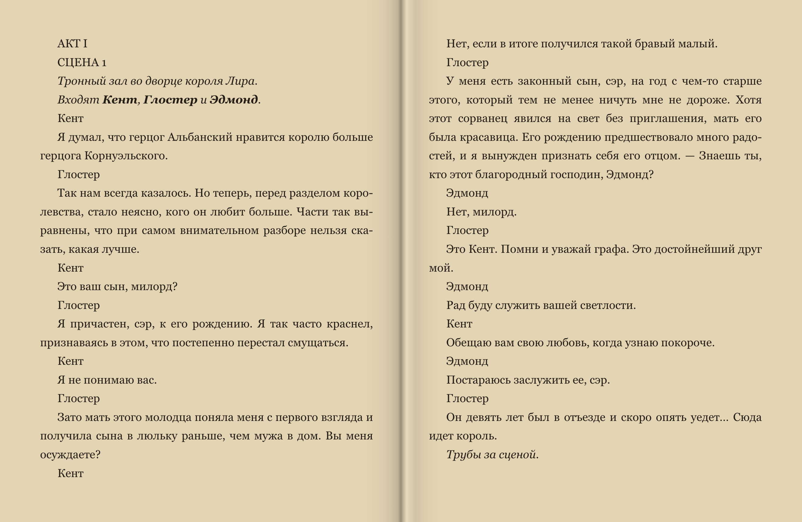
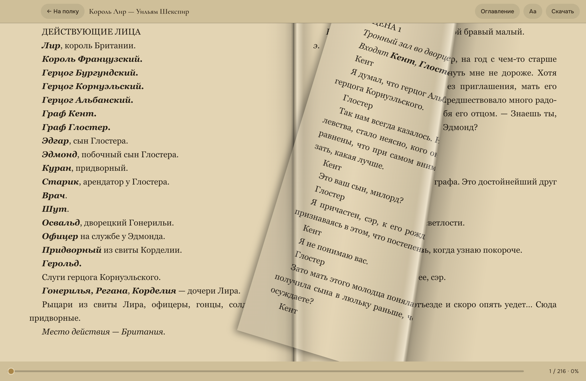

# Pinakes — a virtual bookshelf

[Русский](README.ru.md)

An app for people who read a lot and want their library to look like a real bookcase: dark wood, brass, spines with titles. Your books live in an ordinary folder on your computer and nothing is sent to the internet.



## Features

- **A shelf of spines.** A book slides out of the row on hover, the spine colour comes from the cover. Sort by author, title, date added or reading progress; search.
- **EPUB, FB2 (including fb2.zip) and PDF.** One book in several formats is merged into a single card, even when the author or title is spelled differently. The same file is never added twice.
- **Opening animation.** The book slides off the shelf, the cover opens, pages with the book's own text flip by, and the card appears.
- **A reader** with its own engine for EPUB and FB2:
  - a two-page spread on wide screens, a full-width single page on narrow ones;
  - a "Page" mode with a real page fold that follows your finger or mouse, plus Scroll, Slide, Card, Fade and No animation;
  - Day, Sepia, Graphite and Night themes; font, size, line spacing, margins, alignment, dimming;
  - table of contents, footnotes in a popup, remembered position.
- **FB2 ⇄ EPUB converter.** One click in the card, or in bulk for the whole shelf, with no external tools.
- **Export the whole library** in one format to a folder you choose, handy when moving to an e-reader.
- **An Android version** (APK) with the same shelf and reader.





## Install

Prebuilt packages are on the [Releases](../../releases) page: macOS (universal), Windows (portable `.exe`), Linux (`AppImage`), Android (`.apk`).

The builds are not code-signed, so your system may warn you:
- **macOS:** right-click the app → Open → Open.
- **Windows:** in the SmartScreen dialog choose "More info" → "Run anyway".
- **Android:** allow installing apps from this source.

## Where books are stored

By default in `Documents/Пинакес/Книги`: every book gets its own folder with its files and a `book.json`. You can pick another folder from the menu. Books removed from the shelf go to a `.корзина` ("bin") subfolder and can be restored by hand. On Android the books are stored inside the app.

## Build from source

Requires Node.js 20+.

```bash
cd desktop
npm install
npx electron .
```

Packaging:

```bash
npx electron-builder --mac --universal    # macOS
npx electron-builder --win --x64          # Windows (portable)
npx electron-builder --linux --x64        # Linux (AppImage)
```

Android (needs the Android SDK and JDK 17):

```bash
cd android
./release.sh        # copies the UI from desktop/ui and builds the APK
```

## Layout

- `desktop/` — the Electron app. All book parsing and reading happens in the window (JSZip, DOMParser, pdf.js, epub.js); the Electron main process only reads and writes files.
- `android/` — a Kotlin shell around a WebView, running the same UI as the desktop app (copied by the script).

## License

[MIT](LICENSE). Author: [Индексон / Indexon](https://index-on.ru). The Cormorant Garamond and Onest fonts are under the SIL OFL; pdf.js is Apache-2.0.

Books you add stay on your computer. The app does not upload them and collects no data.
