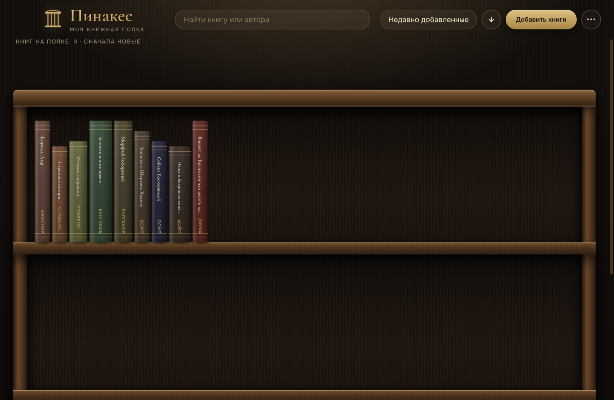
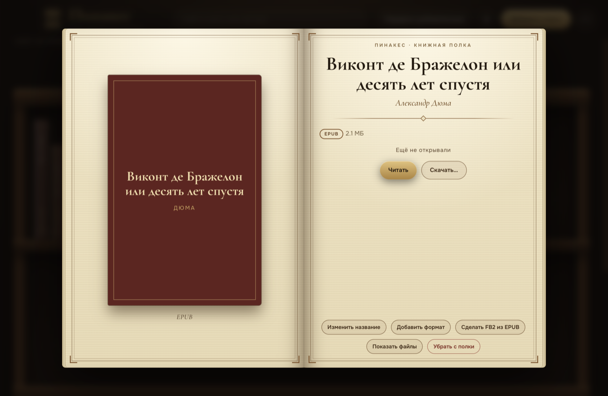
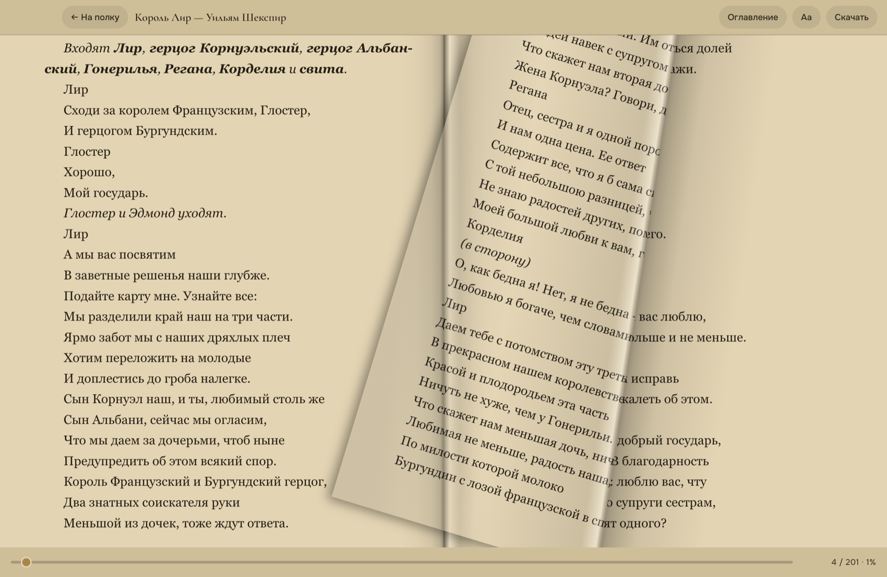

# Пинакес — виртуальная книжная полка

[English](README.md)

Приложение для тех, кто читает много и хочет видеть свою библиотеку как настоящий книжный шкаф: тёмное дерево, латунь, корешки с названиями. Книги хранятся у вас в обычной папке, ничего не уходит в интернет.



## Возможности

- **Полка с корешками.** Книга выезжает из ряда при наведении, цвет корешка берётся из обложки. Сортировка по автору, названию, дате добавления и прогрессу чтения, поиск.
- **Форматы EPUB, FB2 (в том числе fb2.zip) и PDF.** Одна книга в нескольких форматах склеивается в одну карточку, в том числе при разном написании автора и названия. Повторно один и тот же файл не добавляется.
- **Анимация открытия.** Книга выезжает с полки, раскрывается обложка, листаются страницы с текстом самой книги, и появляется карточка.
- **Читалка** с собственным движком для EPUB и FB2:
  - на широком экране (компьютер, планшет, телефон в альбомной ориентации) разворот из двух страниц, на узком одна страница на всю ширину; на Android читалка открывается на весь экран (системные панели прячутся, вернуть их можно свайпом от края);
  - режим «Лист» со сгибом страницы, который следует за пальцем или мышью, а также «Лента», «Слайд», «Карточка», «Затухание», «Без анимации»;
  - темы День, Сепия, Графит, Ночь; шрифт, размер, интервал, поля, выравнивание, яркость;
  - оглавление, сноски во всплывающем окне, запоминание места;
  - **поиск по книге**: слова и фразы, список совпадений с контекстом, переход на страницу и подсветка всех совпадений.
- **Конвертер FB2 ⇄ EPUB.** Один клик в карточке или пакетно для всей полки, без внешних программ.
- **Выгрузка всей библиотеки** в одном формате в выбранную папку: удобно при переезде на электронную книгу.
- **Звуки:** тихий шелест страниц при чтении и звук листания при открытии книги. Отключаются в меню «⋯» и в настройках чтения.
- **Два языка интерфейса:** русский и английский, переключатель в меню «⋯». По умолчанию язык берётся из системы.
- **Версия для Android** (APK): та же полка и читалка.





## Установка

Готовые сборки лежат в разделе [Releases](../../releases): macOS (универсальная), Windows (portable `.exe`), Linux (`AppImage`), Android (`.apk`).

Сборки не подписаны, поэтому система может предупредить:
- **macOS:** правый клик по приложению → «Открыть» → «Открыть».
- **Windows:** в окне SmartScreen нажмите «Подробнее» → «Выполнить в любом случае».
- **Android:** разрешите установку приложений из этого источника.

## Где хранятся книги

По умолчанию в папке `Документы/Пинакес/Книги`: каждая книга лежит в своей папке вместе с файлами и `book.json`. Другую папку можно выбрать в меню. Убранные с полки книги попадают в подпапку `.корзина`, их можно вернуть вручную. На Android книги хранятся внутри приложения.

## Сборка из исходников

Нужен Node.js 20+.

```bash
cd desktop
npm install
npx electron .
```

Сборка пакетов:

```bash
npx electron-builder --mac --universal    # macOS
npx electron-builder --win --x64          # Windows (portable)
npx electron-builder --linux --x64        # Linux (AppImage)
```

Android (нужны Android SDK и JDK 17):

```bash
cd android
./release.sh        # копирует интерфейс из desktop/ui и собирает APK
```

## Устройство

- `desktop/` — приложение на Electron. Всё чтение и разбор книг идёт в окне (JSZip, DOMParser, pdf.js, epub.js), процесс Electron только читает и пишет файлы.
- `android/` — оболочка на Kotlin с WebView, интерфейс тот же, что на десктопе (копируется скриптом).

## Лицензия

[MIT](LICENSE). Автор: [Индексон](https://index-on.ru). Шрифты Cormorant Garamond и Onest распространяются по лицензии SIL OFL; pdf.js — Apache-2.0.

**Звуки** (`desktop/ui/sounds/`) взяты с сайта [zvukogram.com](https://zvukogram.com/category/perelistyivanie-stranits/), где они опубликованы без указанной лицензии, и на них не распространяется лицензия MIT. Если вы правообладатель и хотите, чтобы звуки убрали, откройте issue, и они будут заменены.

Книги, которые вы добавляете на полку, остаются на вашем компьютере. Приложение их не отправляет и не собирает никаких данных.
